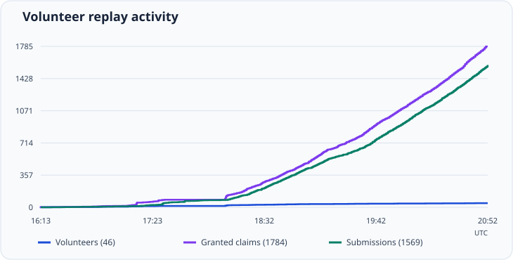

# Volunteer activity

- **Volunteers** counts unique accounts from their first granted claim.
- **Granted claims** counts each issue once, at the time of its first matching bot grant. A single-module issue or a packet covering up to 64 modules each adds one grant. It includes finished and released claims. A denied request does not add to the count.
- **Submissions** counts each claim issue once, at its first evidence comment. The chart includes results awaiting review and the earlier submissions recorded in the reviewed ledger.

The series exclude the coordinator’s cloud-worker reservations. All timestamps are UTC. The workflow refreshes the chart after claim reconciliation, submission comments, or reviewed receipt updates. [Event data](tracker/activity.tsv) · [Current contributor tables](README.md#contributors)
